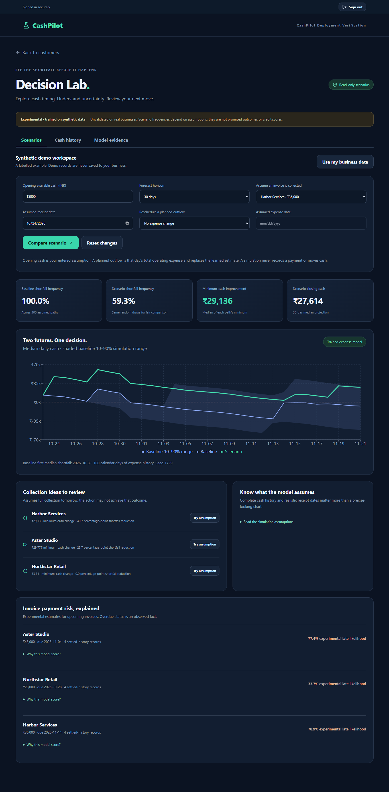

# CashPilot

Explainable cash-flow forecasting and financial scenario planning for small businesses.

[Open the deployed app](https://cashpilot-git-feature-saas-fo-bbd64b-shrashti-agarwals-projects.vercel.app) · [Model card](docs/MODEL_CARD.md) · [Hosted verification](docs/DEPLOYMENT_VERIFICATION.md) · [Decision Lab guide](docs/DECISION_LAB.md)

**Implemented and deployed to staging:** authenticated workspaces, invoices and partial payments, cash-history imports, trained payment-delay and expense models, 7/30/90-day simulations, collection comparisons, disputes and audit history. The preview requires Vercel access. The free backend may need time to wake.



## The problem

A profitable business can still run out of cash when customers pay after expenses fall due. CashPilot combines outstanding invoices, settled payment history, operating expenses and explicit cash assumptions to show when a shortfall could happen and how changing payment timing could affect it.

## Try the complete workflow

1. Sign in, create a business, and open **Decision Lab**.
2. Explore the clearly labelled synthetic demo. Select **Try assumption**, then **Compare scenario** to compare an earlier receipt with the baseline.
3. Change the forecast horizon to 7, 30 or 90 days. Inspect conditional uncertainty, invoice explanations and model evidence.
4. Add customers, invoices and partial payments. Import operating cash history under **Cash history**, then select **Use my business data**.
5. Open and review an invoice dispute; its receipts are excluded from the baseline until resolved. Changes appear in the activity register.

New accounts require email confirmation. Demo records are computed in memory and are never saved to a business. No scenario sends reminders, records payments or executes financial actions.

## Machine learning with evidence

Models are genuinely trained locally with scikit-learn, using reproducible **synthetic-only** data. No LLM API or private customer dataset is involved. These are held-out engineering benchmarks, **not validated accuracy on real businesses**.

| Model / horizon | Held-out result | Baseline |
| --- | --- | --- |
| Calibrated payment logistic regression | ROC AUC 0.808; PR AUC 0.705; Brier 0.175 | Base-rate ROC AUC 0.500; Brier 0.238 |
| Expense totals, 7 days | WAPE 4.4% | Seasonal naive 6.8% |
| Expense totals, 30 days | WAPE 3.4% | Seasonal naive 9.5% |
| Expense totals, 90 days | WAPE 3.5% | Seasonal naive 10.4% |

Payment evaluation uses 3,999 test invoices and purged chronological splits. Expense evaluation uses 96 forecast origins per horizon. Raw logistic regression and gradient boosting results are also published, including cases where calibration does not improve a metric.

Exact additive log-odds contributions explain the served logistic model. A standardized ridge model predicts operating expenses. A paired Monte Carlo simulation combines expense residuals, invoice timing and explicit plans. Its bands and shortfall frequencies are conditional on these assumptions; real-world coverage is unvalidated.

See the [model card](docs/MODEL_CARD.md), [evaluation JSON](backend/models/evaluation.json), [training script](backend/training/train.py) and [architecture](docs/SAAS_ARCHITECTURE.md).

## Architecture and security

React + TypeScript + Recharts on Vercel; FastAPI + SQLAlchemy on Render; Supabase Auth and PostgreSQL. The backend verifies ES256 tokens and membership on every tenant route. Integer paise, composite tenant foreign keys and idempotent partial payments preserve accounting boundaries.

The browser has no direct access to financial tables. A restricted runtime database role connects with certificate and hostname verification. It cannot run migrations, delete business records, or update/delete audit events. Simulation requests have a bounded single-instance rate limit.

[Architecture diagram and trade-offs](docs/SAAS_ARCHITECTURE.md) · [Authentication setup](docs/OIDC_SETUP.md) · [Hosting configuration](docs/SUPABASE_STAGING.md)

## Run and reproduce

Use Python 3.12+ for the API and Node.js 24 for the frontend. Configure the SaaS variables from the [authentication guide](docs/OIDC_SETUP.md) and [backend hosting guide](docs/BACKEND_HOSTING.md); never commit credentials.

```bash
cd backend
python -m venv .venv
# Activate .venv for your platform.
pip install -r requirements.txt
alembic upgrade head
uvicorn saas_main:app --reload --port 8000
```

In another terminal:

```bash
cd frontend
npm ci
npm run dev
```

Training is separate from the lightweight inference runtime. Exact training package versions and the Python version used are recorded in the model card and evaluation artifact:

```bash
cd backend
pip install -r training/requirements.txt
python training/train.py
python -m pytest -q
```

Frontend validation: `npm test` and `npm run build` from `frontend`. Current checks: **62 backend tests, 22 frontend tests**, production frontend build and Docker CI. The [hosted report](docs/DEPLOYMENT_VERIFICATION.md) records genuine browser → Auth → API → database verification.

## Scope and limitations

This release is a working ML portfolio application. Synthetic model performance does not establish real MSME accuracy, creditworthiness or causal benefits. Insufficient expense history is disclosed, and planned outflows replace that day's estimated total expense. CSV imports append rows; users must review duplicates.

Bank feeds, GST compliance, buyer portals, automatic outreach, billing and full regional translation remain separate roadmap items in the [coverage register](docs/MARKET_GAP_COVERAGE.md). Backup/restore drills, distributed rate limiting and real-data model validation remain prerequisites for broader operational use. Supabase reports that leaked-password protection is disabled.

The old unauthenticated `main:app` transaction demo is for local development only. Hosted deployments use `saas_main:app`. Work remains on `feature/saas-foundation`; no main merge or paid infrastructure has been enabled.
