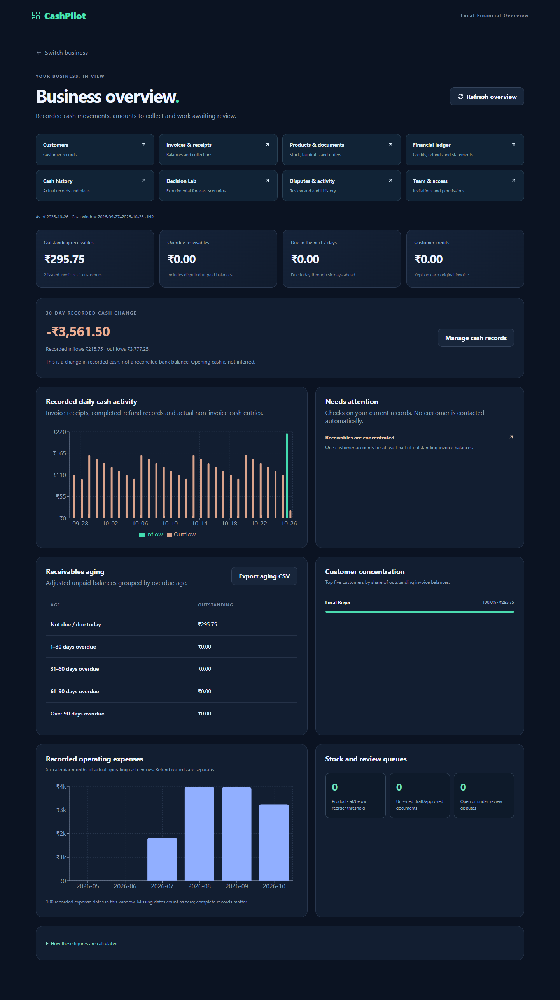

# Business overview — local build

The overview is now the initial business screen in the local build. It is not
deployed. Navigation opens customers, invoice receipts, operations, financial
ledger, cash history, Decision Lab, disputes and owner/admin team settings.

## Recorded facts

- Outstanding and overdue amounts use invoice charges adjusted by internal memos,
  posted receipts and recorded external refunds. Customer credits remain separate.
- Aging uses the business day in Asia/Kolkata. Due today is not overdue; the seven
  day window covers today through six days ahead.
- Customer concentration is each customer's share of total unpaid invoice balances.
  The display lists the top five; it does not imply a creditworthiness assessment.
- Thirty-day cash activity combines invoice receipts, external-refund records and
  actual non-invoice cash entries. Planned, voided and future cash entries are
  excluded. Invoice receipts must not also be entered as other income.
- Cash change is explicitly **not a reconciled bank balance**. No opening balance
  or bank feed is invented. Negative changes use a distinct warning color.
- Six-month expense charts include actual operating cash entries. Refund records
  are excluded from operating-expense totals. The current month may be incomplete.
- Attention flags describe recorded overdue balances, customer concentration,
  insufficient expense dates, low ledger stock and unissued documents. They do
  not send messages or execute financial actions.

The overview supports up to 2,000 invoices and 10,000 records in each relevant
cash window. Broader pagination/performance work remains in the enterprise plan.
It uses no trained-model forecast; experimental projections remain in Decision Lab.

## Verification

Accounting tests reconcile receipts, memos, refunds and actual cash entries;
exclude planned/voided and foreign-tenant data; check aging, concentration, queues
and immediate access denial after membership deactivation. Frontend tests verify
the distinction between recorded cash change and bank balance, module navigation,
role controls and error states without fabricated metrics.

The local browser loaded the overview against a disposable migrated database with
100 explicitly generated operating-expense fixtures. API totals matched the UI,
the cash-history shortcut opened the correct tab, desktop/mobile charts rendered,
and no page errors or horizontal page overflow were observed. This local fixture
verification does not establish hosted Auth, bank reconciliation or real business
data quality. Current checks: **79 backend tests, 42 frontend tests, frontend build**.
