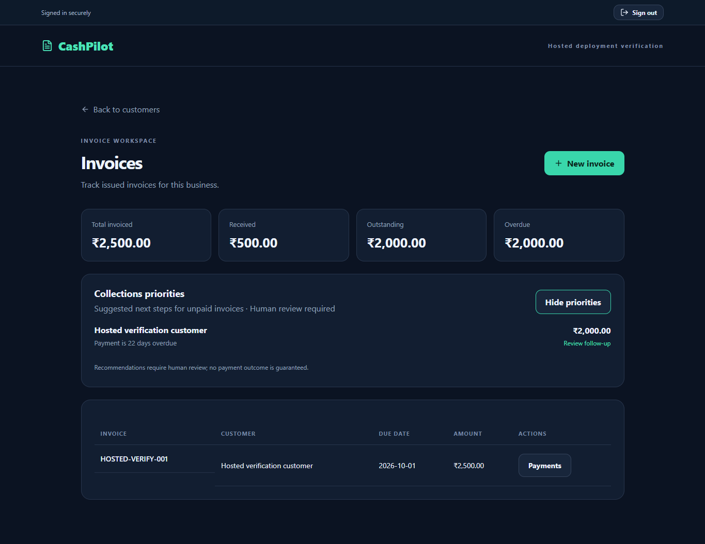

# Deployment verification — 23 October 2026

Story: an owner signs in through the deployed React app, creates a workspace,
customer and invoice, records a partial payment, and sees the correct balance
returned by FastAPI from Supabase. Another user cannot access those records.

Executable commit: `1eb16b08ae4099fc96b5c07e8e56b1a889db1524`.
Render deployment: `dep-dbdehvqhv4oc73bnf4og`, status `live`.
Branch: `feature/saas-foundation`; PR remains draft.

## Flow results

| Boundary | Evidence |
| --- | --- |
| Browser renders | Desktop sign-in and 390px mobile signup layouts inspected; no horizontal overflow |
| Authentication | Two temporary confirmed identities signed in through real Supabase Auth; HTTP 200 and genuine ES256 tokens |
| Browser → API | Workspace, customer, invoice and partial payment created through the hosted UI |
| API → database | Restricted backend login connected through the pooler with certificate and hostname verification |
| Database → response | Invoice 250000 paise, payment 50000 paise, exactly one payment record |
| Response → browser | ₹2,500 invoiced, ₹500 received, ₹2,000 outstanding and overdue |
| Collections | Overdue invoice received a rule-based follow-up suggestion and human-review notice |
| Token refresh | Supabase refresh HTTP 200; refreshed token accepted by hosted API, HTTP 200 |
| Sign-out / switch user | Protected UI removed; second user's workspace list was empty |

## Safety and operational checks

| Check | Result |
| --- | --- |
| `/health` and `/ready` | Both HTTP 200 |
| Missing bearer token | HTTP 401 |
| Other tenant's customers, invoices, summary, collections and payment history | All five HTTP 403 |
| Untrusted origin preflight | HTTP 400 |
| Duplicate payment request | Same payment ID; payment count unchanged |
| Overpayment | HTTP 422 |
| Browser database privileges | No SELECT privilege or membership of backend role |
| Database security advisor | No findings |
| Runtime errors after successful rollout | None in the verification interval |

All three GitHub workflows passed for the executable commit. Local validation
passed 46 backend tests, 17 frontend auth tests, TypeScript and the production
frontend build. The frontend dependency audit reported zero vulnerabilities.

## Test data and limits

Two temporary identities were provisioned administratively with reserved,
non-deliverable email addresses and generated passwords. No test emails were
sent. They exercised genuine password sign-in and refresh, rather than signup
confirmation email delivery. All temporary identities, auth sessions and business
records were deleted afterward: zero test users and zero test organizations remained.

The screenshot shows temporary verification data before cleanup:

These checks establish a working staging deployment of the current SaaS
foundation. Production readiness, trained models, email delivery reliability and
the planned Decision Lab are not established by these checks.
