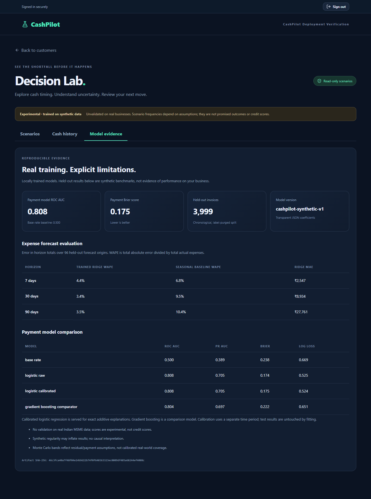
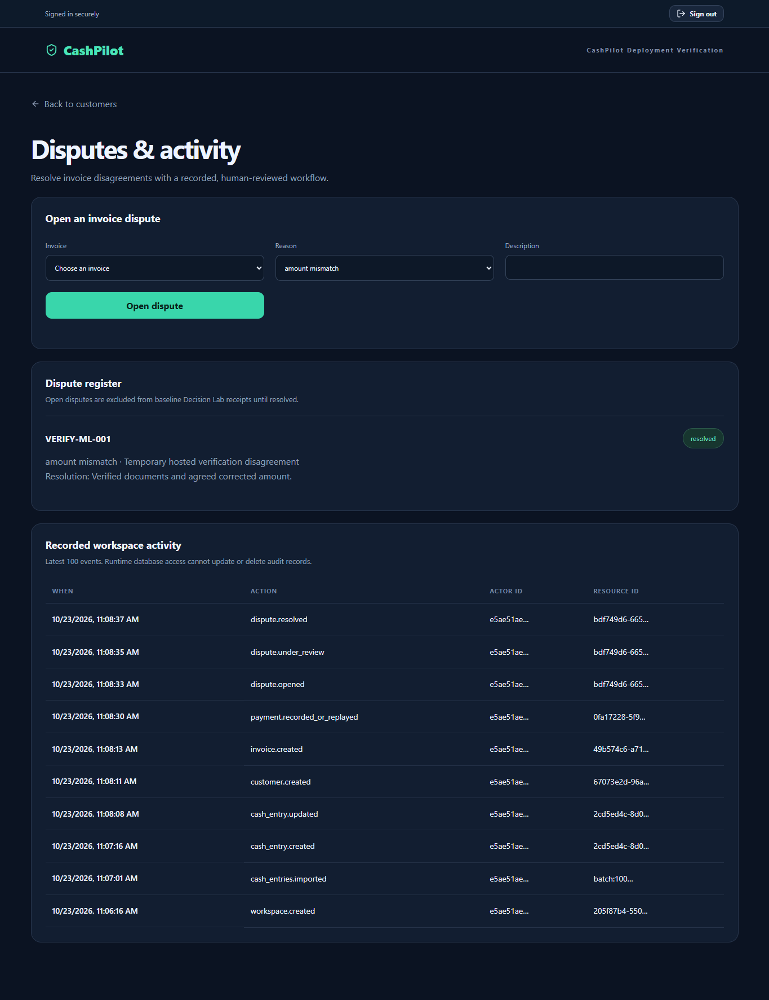

# Hosted release verification — 23 October 2026

Executable commit: `ba1173b716b8abcbd826467e555d464ed00173a6`.
Render deployment: `dep-dbdf45vavr4c739rtqc0`, **live**.
Vercel deployment: `dpl_6n9V4QLSaui5WjBkWvCkcrJjE4B7`, **READY**.
Schema: `0005_audit_events`.
Branch: `feature/saas-foundation`; PR remains draft.

[Open hosted application](https://cashpilot-git-feature-saas-fo-bbd64b-shrashti-agarwals-projects.vercel.app) · [Machine-readable results](hosted-verification.json)

## Verified story

An owner signed in through the deployed React app using genuine Supabase Auth tokens, created a business, imported cash history, corrected a cash entry, created a customer and invoice, recorded a partial payment, opened/reviewed/resolved a dispute, and ran the trained models through Decision Lab.

| Boundary | Observed result |
| --- | --- |
| Browser → Supabase Auth | Genuine password sign-in succeeded; confirmation settings remained enabled |
| Browser → API → PostgreSQL | Workspace, customer, invoice, payment, 100 CSV entries and entry correction persisted |
| Invoice arithmetic | ₹45,000 invoice minus ₹5,000 payment = ₹40,000 outstanding in model input |
| No expense history | UI displayed **Not assessed**, not a manufactured risk percentage |
| Imported operating history | 100 calendar days; hosted inference reported trained_ridge_expenses |
| Model → forecast → browser | 7/30/90 requests returned HTTP 200 with exactly 7/30/90 daily points |
| Scenario comparison | Synthetic example: assumed collection improved median path-minimum by ₹29,135.73; same random draws |
| Dispute workflow | Open → under review → resolved; required note persisted; open dispute flagged and excluded from baseline receipts |
| Audit history | Workspace, customer, invoice, payment, import, correction and all dispute transitions recorded |
| Mobile | 390px Scenarios and Model evidence layouts had no horizontal page overflow |
| Browser runtime | No JavaScript page errors observed |

The synthetic scenario is an assumption-driven illustration, not an achieved business outcome. The demo does not save its records.

## Security and operations

| Check | Observed result |
| --- | --- |
| /health and /ready | Both HTTP 200 |
| Missing bearer token | HTTP 401 for cash entries, model evidence, disputes and audit |
| Other tenant | HTTP 403 for all four routes |
| Unknown scenario reference | HTTP 422 |
| Runtime audit privileges | UPDATE and DELETE denied |
| Browser cash-ledger privileges | SELECT denied for anon and authenticated |
| Render error logs | No error-level events during the post-rollout verification interval |
| Supabase security advisor | One warning: leaked-password protection disabled |

Earlier hosted foundation checks also verified refresh, sign-out, other-tenant invoice/customer access, duplicate-payment idempotency, overpayment rejection, and untrusted-origin rejection. Those results predate the ML release; the new release's checks are recorded separately above.

All three GitHub workflows passed for the executable commit: backend tests, frontend build and SaaS container build. Local validation passed **62 backend tests and 22 frontend tests**, TypeScript and the production frontend build. Training ran twice and produced the same model artifact hash:

`46c3fca40a7f48f04e14b9d22b74f0f640363323ec0009df485a68244ef4008c`.

## Test data

Two reserved example.invalid identities were provisioned administratively with random passwords. They exercised genuine Auth sign-in; no test emails were sent. All verification business records, sessions and identities were removed afterward. Screenshots show temporary records before cleanup.

## What this establishes

The complete portfolio workflow, including trained-model inference, is deployed and verified in staging. It does not establish real-business model accuracy, confirmation-email delivery, production load capacity, backup restorability or regulatory compliance. See the [model card](MODEL_CARD.md) and [architecture](SAAS_ARCHITECTURE.md).
