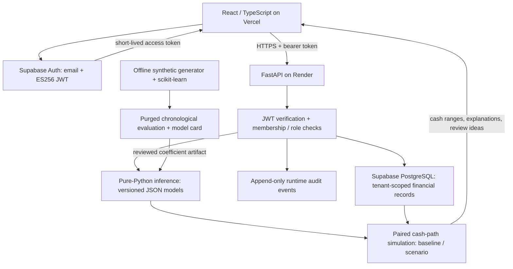

# CashPilot architecture

Implemented on the feature branch and deployed to authenticated staging on 23 October 2026. This describes the running portfolio release. The larger market-gap roadmap is separate.

## Trust boundaries

- The browser receives only the public Auth key. Tokens refresh in memory; financial table privileges are revoked from browser roles.
- FastAPI validates issuer, audience, ES256 signature and authenticated role. Every organization route checks membership; viewer writes are denied.
- Application reads and writes filter by organization. Composite foreign keys prevent a customer or payment reference crossing organizations.
- RLS restricts access to the trusted backend role. These policies do **not** independently partition tenants within that role: application authorization remains essential.
- The runtime role has financial SELECT/INSERT/UPDATE and audit SELECT/INSERT only. No deletes, schema changes, superuser or global RLS bypass.
- The IPv4 Supabase session pooler uses TLS certificate and hostname verification. Schema changes run administratively through Alembic, separately from the application login.

## Persistent records

Organizations and memberships establish owner/admin/accountant/viewer roles. Customers own invoices; posted partial payments determine outstanding balances. Disputes move from open to under review to resolved with a required note. Operating cash entries support actual, planned and void states.

Audit events record actor, organization, action, resource and timestamp in the same transaction as changes. They exclude tokens, CSV bodies and request payloads. They are append-only for the runtime role, not immutable against a database administrator.

Money is stored in integer paise. CSV parsing uses Decimal and rejects fractional paise atomically. Imports append rows and do not infer duplicates.

## Inference and simulation

Payment features use only settlements known before the scoring date. The served standardized logistic model includes sigmoid calibration and exact additive log-odds explanations. Overdue status is displayed as a fact rather than a new model prediction. Disputed receipts are excluded unless the user explicitly overrides timing.

The ridge expense model uses lags, rolling means, weekday and month-end features. Workspaces require at least 56 calendar days and 28 expense dates; shorter histories use a disclosed trailing-mean fallback. No history produces no learned expense forecast and the UI says shortfall risk is not assessed.

Three hundred conditional paths use empirical training payment delays and validation expense-residual blocks. Baseline, scenario and collection comparisons share random draws. Scheduled expenses replace the day's total learned expense; rescheduling conserves obligations and discloses amounts deferred beyond the horizon. Simulations never write payments or execute actions.

The runtime uses JSON coefficients and the Python standard library, avoiding scikit-learn memory/dependency overhead in the free web service. Training packages are pinned separately. The artifact checksum and all candidate/baseline results are published.

## Deployment and trade-offs

Vercel branch Preview → Render free Docker service → Supabase PostgreSQL. Exact CORS origins are configured. Render auto-deploy is disabled; deploy after successful CI. Liveness and readiness endpoints are separate. The frontend handles loading, failure, retry and read-only roles.

Synchronous inference is adequate for the bounded evaluation release: up to 200 outstanding invoices, 2,000 invoices overall, 10,000 cash entries, 90 forecast days and 20 simulations per identity/workspace/minute. The limit is process-local and resets on restart; multi-instance deployment requires shared limits.

No public SaaS WebSocket, file attachment processor, queue worker or external AI service is deployed. The legacy transaction demo remains local and separate.

## Operational limits

The free backend can sleep. Real-world model validity, calibrated interval coverage, backup restore drills, load testing and incident response are not established by the portfolio tests. Supabase's latest advisor reports leaked-password protection disabled. Email confirmation is required; verification did not test actual confirmation-email delivery.

See [hosted verification](DEPLOYMENT_VERIFICATION.md), [model card](MODEL_CARD.md), [Decision Lab guide](DECISION_LAB.md) and [future coverage](MARKET_GAP_COVERAGE.md).
